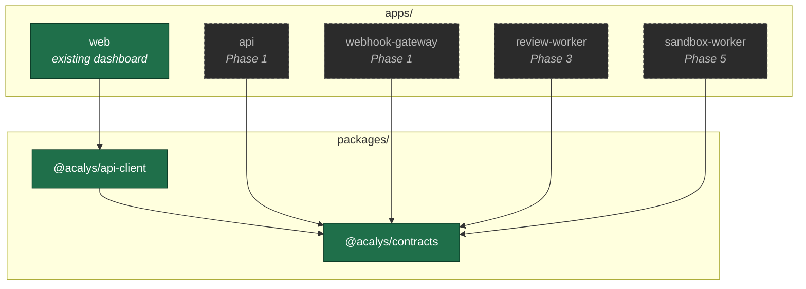
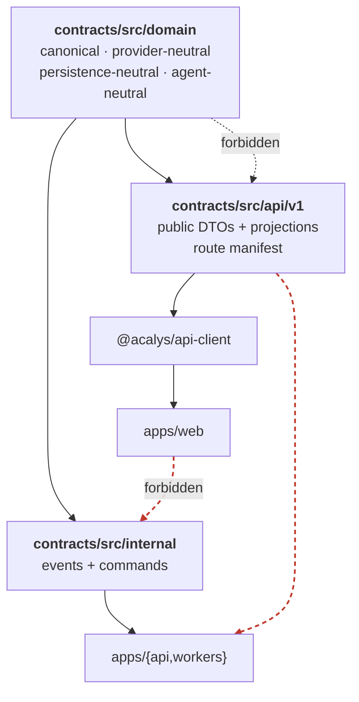
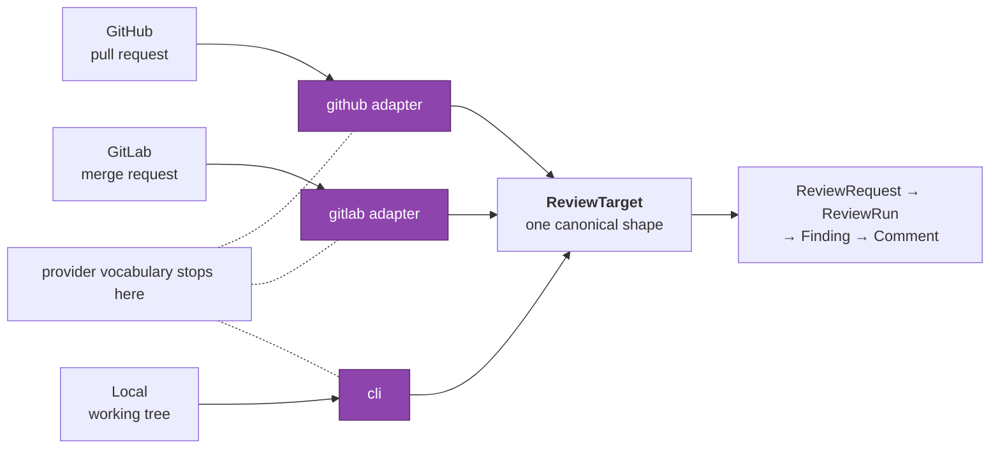
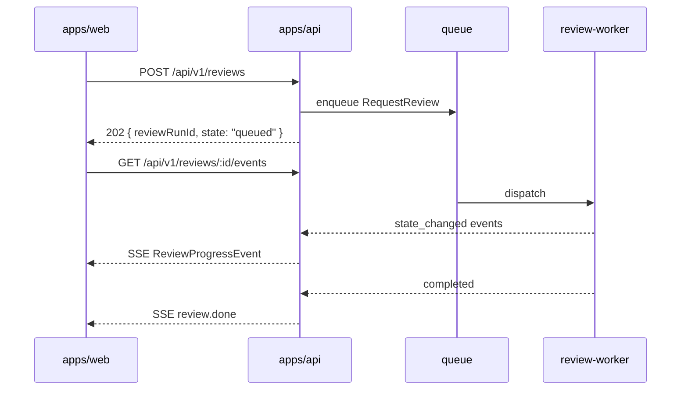

# Architecture

Phase 0 builds the language the platform speaks. No reviewer, no webhook, no clone, no
analyzer, no sandbox, no HTTP server, no database, no queue (§88–§91). What it builds is
the set of contracts every later phase is written against, and the boundaries that keep
those phases from reaching into each other.

---

## The monorepo



Solid nodes exist today. Dashed ones are named here with the phase they land in, and are
**not** scaffolded — fifteen empty stub packages would be the speculative abstraction
§131 warns against. Nothing gets bolted on later because the workspace globs
(`apps/*`, `packages/*`) and the resolution already work.

---

## The three contract layers

This is the heart of the phase.



`domain` is the base of the graph and imports from neither layer above it. DTOs are
projected **from** the domain by explicit `toDto()` functions; events are built **on** it.
Neither direction is ever reversed, and dependency-cruiser fails the build if it is.

The package publishes three subpath exports, so the boundary is enforced by import path
rather than by discipline:

```
@acalys/contracts/domain     canonical types
@acalys/contracts/api/v1     what apps/web may see
@acalys/contracts/internal   workers only
```

### The two invariants this shape exists for

```
Frontend UI      ──must NOT depend on──>  review-worker internals
Review workers   ──must NOT depend on──>  frontend component structure
```

They meet at `@acalys/contracts` and the versioned HTTP API, and nowhere else. Every rule
in `.dependency-cruiser.cjs` traces back to one of these two lines.

---

## Provider normalization (§1)



Everything left of the adapters speaks a provider's language. Everything right of them
speaks the platform's. `tests/fixtures.test.ts` proves the boundary holds by normalizing a
GitHub PR and a GitLab MR describing the same change, then asserting the results are equal
once provider identity is removed.

The `local` path is the strongest evidence: a working-tree target has no provider, no
change request, and nowhere to post a comment, and it is still a first-class review target
(§112). A domain that had absorbed GitHub's model could not express it.

---

## The async command path



`202`, not `200`, is a contract decision rather than a style one. A review takes minutes
and runs on a worker that may not exist when the response is written. A synchronous
response would hold a connection open for the duration and couple response time to worker
throughput — which is precisely the coupling that makes horizontal scaling visible to the
frontend.

Phase 0 defines `ReviewProgressEvent` and the route, so the live experience is designed in
from the start. Neither the queue nor the worker appears anywhere in the API.

---

## Where each vocabulary lives (§76)

| Kind                | Location                          | Audience                     | Versioning                       |
| ------------------- | --------------------------------- | ---------------------------- | -------------------------------- |
| Domain contracts    | `contracts/src/domain`            | every backend package        | `schemaVersion` per durable root |
| API contracts       | `contracts/src/api/v1`            | `apps/web`, external clients | the URL (`/v1`)                  |
| Event contracts     | `contracts/src/internal/events`   | workers, outbox              | `schemaVersion` on the envelope  |
| Command contracts   | `contracts/src/internal/commands` | dispatchers                  | `schemaVersion` on the envelope  |
| Transport contracts | `@acalys/api-client`              | `apps/web`                   | follows the API version          |

Domain `schemaVersion` and the API version move **independently**, and that independence is
the point: a worker refactor that bumps a domain version must be invisible to the UI.

---

## Enforcement

Every boundary is a rule that fails the build, and every rule has been proven to fail by
planting a real violation and watching CI reject it.

| Invariant                          | Mechanism                                      | Planted violation                                      |
| ---------------------------------- | ---------------------------------------------- | ------------------------------------------------------ |
| No provider SDK in contracts (§59) | ESLint `no-restricted-imports`                 | `import { Octokit } from "@octokit/rest"` in `domain/` |
| Domain never imports API           | dependency-cruiser                             | `domain/` → `api/`                                     |
| UI never sees internals            | dependency-cruiser                             | `apps/web` → `contracts/internal`                      |
| SDK never sees internals           | dependency-cruiser                             | `api-client` → `contracts/internal`                    |
| Workers never see the UI           | dependency-cruiser                             | any package → `apps/web`                               |
| No DTO leakage                     | schema walk in `tests/api/dto-leakage.test.ts` | `attempt` added to `ReviewRunDto`                      |
| Generated schemas match source     | `npm run schemas:check`                        | renamed a property in a generated file                 |
| Exhaustiveness (§85)               | `assertNever`                                  | a new union variant                                    |

`npm run verify` runs typecheck, lint, dependency-cruiser, the schema drift check, and the
tests. CI runs the same plus formatting and both builds.
