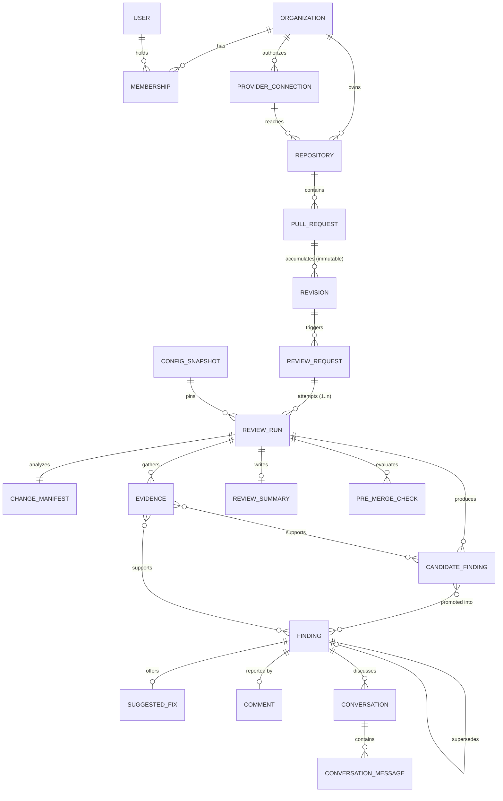

# Domain model

The canonical entities, how they relate, and the distinctions the model refuses to
collapse. Every "why" below corresponds to a bug the merged version would have.

---

## Entity relationships (§82)



`REVIEW_REQUEST ||--o{ REVIEW_RUN` is the relationship most systems get wrong, and the one
everything else depends on. See below.

---

## The distinctions the model keeps

### ReviewRequest is not ReviewRun (§16)

```
ReviewRequest    intent      "review revision 3 of PR #412"   happens once
ReviewRun        attempt     "the second try at that"          happens 1..n times
```

Merging them means a retry either overwrites the failed attempt — destroying the record of
why it failed — or creates a second _request_, which then looks like the user asked twice.
Neither is recoverable. With them separate, `unique (request_id, attempt)` makes each
attempt a row, and "why did this review fail twice?" is answerable.

It is also what makes idempotency expressible: the _request_ carries the idempotency key,
so a redelivered webhook finds the existing request instead of starting new work.

### CandidateFinding is not ReviewFinding (§27)

```
CandidateFinding   claim, proposedSeverity, producedBy       unverified
ReviewFinding      severity, confidence, verification,       verified
                   fingerprint, lifecycle
```

Genuinely different types, not one type with a flag. A candidate carries a **claim** — a
falsifiable assertion a verifier evaluates — where a finding carries a settled severity
and the verification that produced it. §107 requires that a published finding cannot be a
rejected candidate; with two types that invariant is structural, because there is no row
to be in the wrong state.

The promotion is many-to-many: three tools reporting the same issue become one finding, and
`candidateIds` records all three.

### A summary is not a list of findings (§33)

A change with zero findings still needs a summary. Deriving one by concatenating findings
produces a list, and leaves the Walkthrough and Risk views empty.

### A pre-merge check is not a finding (§44, §132)

```
finding   a claim about the code:    "this query is injectable"   → severity
check     a claim about the change:  "it meets our merge policy"  → status
```

A check has a **status**, never a severity. Sharing the vocabulary would make severity
start to mean "blocking", and merge policy would end up tuned by re-grading defects.

`inconclusive` is a distinct status from both `failed` and `passed` — the distinction a
boolean loses. Collapsing it into `failed` blocks merges on the platform's own uncertainty;
into `passed`, an unevaluated policy reads as satisfied.

### A risk area is not a finding

"Look here" and "this is wrong" are different claims. A migration that appears correct is a
risk area and is not a defect; conflating them either hides the risk or fabricates a bug.

---

## Identity

Every entity id is a **branded** UUIDv7.

```ts
type RepositoryId = Brand<string, "RepositoryId">;
type ReviewRunId = Brand<string, "ReviewRunId">;

// Compile error. Both are strings at runtime; neither is assignable to the other.
const run: ReviewRunId = repositoryId;
```

UUIDv7 because it is time-sortable and generable without coordination — a worker mints an
id without a round trip, and `ORDER BY id` is chronological. Branded because the two most
common data-corruption bugs in a system with a dozen id types are passing the wrong one and
comparing across types, and both are silent with bare strings.

`domain/identity/ids.ts` is the single owner of all 21 id types (§99). A `RepositoryId`
declared in a second place is a second type that looks identical and is not assignable.

**Never identity:** a repository name (renames), a PR number (per-repository at best,
shared across resource types on GitLab), a file path (moves), a line number (shifts on any
edit above).

---

## Fingerprints: identity that survives movement (§28)

The hardest contract in Phase 0, and the one incremental review rests on.

```
revision 1   src/auth.ts:82   SQL injection in Session.verify
revision 2   src/auth.ts:97   SQL injection in Session.verify   ← the same issue
```

Both must produce the same fingerprint. Adding an import at the top of a file shifts every
line below it; a fingerprint that included line numbers would report every finding in that
file as fixed and immediately re-raise all of them as new.

| Excluded                   | Why                                                    |
| -------------------------- | ------------------------------------------------------ |
| line and column            | shift on any edit above, and on reformatting           |
| title, explanation         | model wording varies run to run for one issue          |
| `FindingId`, `ReviewRunId` | new every run by construction                          |
| evidence, and its order    | the same issue can be found by different tools         |
| severity, confidence       | re-grading an issue does not make it a different issue |

**Included:** repository, category, detector, path, a semantic anchor (symbol → content →
path, in that order of preference), and an `issueKey`.

`issueKey` is a machine vocabulary term — `acalys.security.sql-injection`, or a tool's rule
id — never prose. Normalizing a model's sentence into a key was considered and rejected:
any normalization aggressive enough to absorb rewording would also merge genuinely
different issues.

The inputs are serialized with `canonicalJson` and hashed, so key order cannot change the
result:

```json
{
  "algorithm": "acalys.fingerprint.symbol-anchor",
  "anchor": "symbol:method:auth.Session.verify",
  "category": "security",
  "detector": "acalys.agent.reviewer",
  "issueKey": "acalys.security.sql-injection",
  "path": "src/auth.ts",
  "repositoryId": "…",
  "version": 1
}
```

---

## Evidence and verification (§30, §32)

Evidence is **first-class**, not a string on a finding. It has its own identity,
provenance, and strength, and it is shared: one SARIF result can support three findings.

```
weak  <  supporting  <  strong  <  deterministic
```

Provenance is a discriminated union — `tool | agent | ci | repository | external` — so
"where did this come from?" is answerable from the record rather than from a log. A finding
whose evidence is all `weak` and a finding backed by a reproduced runtime trace are
different claims, and the model can tell them apart.

Verification is a separate, independent decision (§32), with its own reason codes drawn
from a closed vocabulary. A reviewer that graded its own output would have no check on its
confidence.

---

## Artifacts: references, never blobs (§45)

**Bounded text lives in the contract; unbounded content lives in an artifact.**

A finding explanation is a paragraph. A full analyzer log is an `ArtifactReference` — id,
content type, size, checksum, classification, redaction state, and an opaque storage
locator. Without this rule one 40 MB SARIF file becomes a 40 MB queue message, a 40 MB row,
and a 40 MB payload re-validated on every worker hop.

Disclosure is a **policy question answered before the bytes are fetched**:

```ts
canDisclose(artifact, "public_surface" | "provider_comment" | "tenant_surface");
```

Two rules, both enforced: pending redaction is never disclosable, and `not_required`
redaction does not override the data classification. An earlier draft returned `true` for
`tenant_private` + `not_required`, which silently made every tenant-private artifact
world-disclosable — the bug that motivated replacing a boolean with a destination-aware
function.
