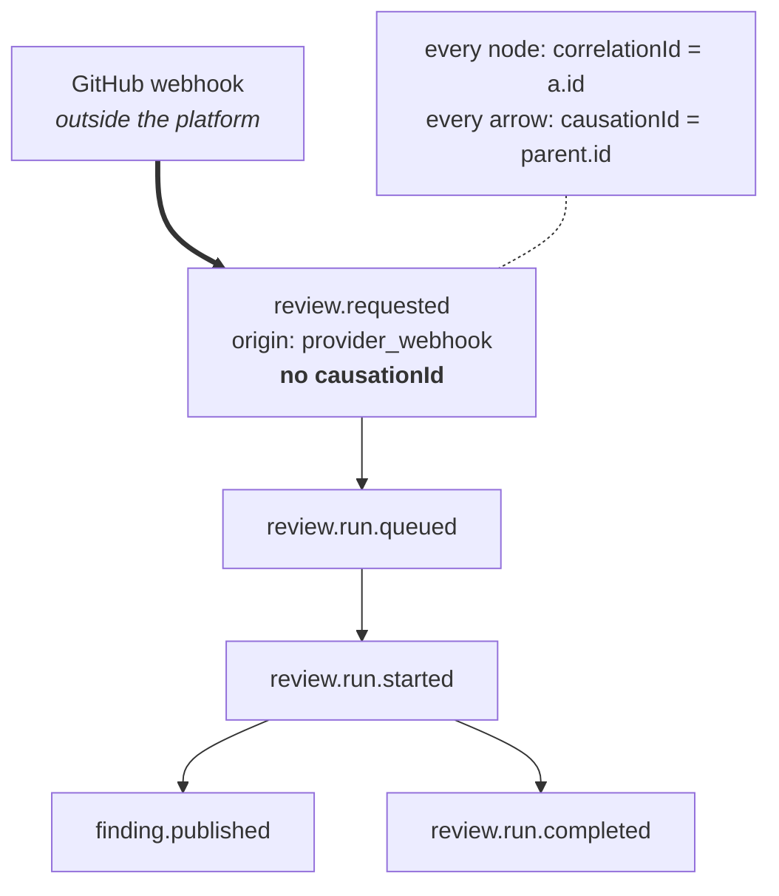

# Events and commands

Two message kinds, two envelopes, deliberately un-shared.

---

## Command versus event (§77)

|                 | Command                                     | Event                         |
| --------------- | ------------------------------------------- | ----------------------------- |
| Means           | _please do this_                            | _this already happened_       |
| Tense           | imperative — `review.request`               | past — `review.run.completed` |
| Can be refused? | **yes** — validation, authorization, policy | no; a fact cannot be rejected |
| Recipients      | exactly one handler                         | any number of subscribers     |
| Carries         | `issuedBy`, `idempotencyKey`, `issuedAt`    | `occurredAt`                  |

The envelopes are separate even though four fields coincide. A shared base would converge
them under maintenance — someone adds a field "to the envelope" and it lands on both — and
that is exactly the single generic message model §77 forbids. Every event would then carry
an optional `actor` and an optional `idempotencyKey`, and consumers would have to know
which events happened to be commands in disguise.

A command has no `occurredAt` because **nothing has occurred yet**. It has `issuedAt`:
when someone asked.

### Commands are not the HTTP API

`POST /api/v1/reviews` is a _request_. The command is what the API layer constructs from it
after authenticating and authorizing (§76). Keeping them apart is what lets the same
command arrive from a webhook, a CLI, or a scheduler without any of them speaking HTTP.

---

## Causation (§49)



§49 asks that these not be "optional everywhere without thought". The policy:

| Field           | Required?                        | Why                                                                                                                                        |
| --------------- | -------------------------------- | ------------------------------------------------------------------------------------------------------------------------------------------ |
| `correlationId` | **always**                       | an event that cannot be tied to the work that produced it is unusable exactly when it matters — reconstructing a review during an incident |
| `causationId`   | **except at a declared ingress** | a webhook was caused by something outside the platform; inventing a parent id for it would be a lie in the audit trail                     |
| `traceId`       | optional                         | a worker without an OpenTelemetry SDK must still emit correct events, and forging a trace id it cannot join is worse than omitting one     |

A root event names its `origin` — `provider_webhook`, `api_request`, `scheduler`, `cli`,
`internal`. Naming the ingress explicitly is what makes a _missing_ `causationId` elsewhere
detectable as the bug it is, rather than an unexplained absence. The schema rejects a
message that is both caused and an ingress, and one that is neither.

`causedBy(parent)` is the only sanctioned way to continue a chain. Written by hand the
mistake is always the same: copying `correlationId` and forgetting `causationId`, which
leaves a trace that groups correctly and orders wrongly.

---

## The taxonomy (§48)

17 event types. §48's constraint on membership is the one that matters: _avoid
overproducing tiny internal implementation events — events should represent meaningful
domain transitions._

The test: would this fact still be interesting to someone who did not write the worker that
emitted it? `review.run.state_changed` is — it is the lifecycle.
`review.run.tool_invoked` is not, and publishing it would make every consumer's exhaustive
switch churn on a refactor that changed no domain behaviour.

```
review.requested              repository.revision.created
review.run.queued             change_manifest.created
review.run.started
review.run.state_changed      finding.candidate_created
review.run.completed          finding.verified
review.run.failed             finding.rejected
                              finding.published
conversation.message_created  finding.resolved
premerge.check_completed      finding.dismissed
                              finding.superseded
```

Names are `noun.past_tense_verb`, always past tense — a test asserts no type ends in an
imperative form, because an imperative name reads as a command.

### Payloads carry references, not entities

A payload holds ids plus the few fields a consumer routes on. It does not embed the entity:

- An event is **immutable**; an entity is not. Embedding a `ReviewFinding` freezes a copy
  that is wrong the moment the finding is resolved, and a consumer has no way to know which
  it holds.
- Events are replayed, stored, and shipped between processes. A `ChangeManifest` for a
  5000-file change would be megabytes, in every subscriber's queue, forever.

`finding.published` therefore says _which_ finding, plus `severity` and `category` so a
notification rule can filter without a database round trip. That is the one deliberate
exception, and the reason it is worth making.

`finding.rejected` carries a **candidate** id, not a finding id: a rejected candidate never
became a finding, and minting one to describe its rejection would put a finding nobody
should see into every consumer's store.

`review.run.failed` carries a stable `errorCode` and `retryability` — never a message,
never a stack (§125).

---

## Commands (§78)

Seven. Each corresponds to a transition that already exists in a state machine written in
Checkpoint B or C, so none is speculative (§131). A command for a capability that does not
exist yet would be a guess about its shape.

```
review.request        finding.dismiss          fix.request
review.cancel         conversation.resolve     premerge.run_check
review.rerun
```

`idempotencyKey` is **required**, not optional (§47). A command that can be retried without
one is a command that can execute twice, and the two common paths — a webhook redelivery
and a queue's at-least-once guarantee — both retry by default. Making the key optional
means the safe case is the one you have to remember.

Deduplication is scoped by `(organizationId, type)`. A global key space would let one
tenant's retry silently suppress another's command — a cross-tenant leak through a
deduplication table.

`finding.dismiss` requires a reason, where the corresponding _event_ leaves it optional. A
human dismissing a finding is making a judgement, and an unexplained dismissal is
unreviewable later; the event records what happened, the command records the ask.

---

## Outbox readiness (§67)

The failure the envelope is designed to make survivable:

```
BEGIN
  UPDATE review_runs SET state = 'completed'
COMMIT                              ← committed
  publish("review.run.completed")   ← process dies here
```

The state changed and nobody was told, with no record that an event was owed.

An outbox writes the event row **inside the same transaction** as the state change; either
both land or neither does. A relay publishes unpublished rows afterwards — at-least-once,
which is why every event carries a stable `id` for consumers to deduplicate on, and why
`correlationId`/`causationId` are columns rather than JSONB (reconstructing a chain is a
recursive query over exactly those two fields).

Phase 0 provides the envelope and the ids. The outbox table is in
[persistence-plan.md](./persistence-plan.md); the relay is Phase 1.
