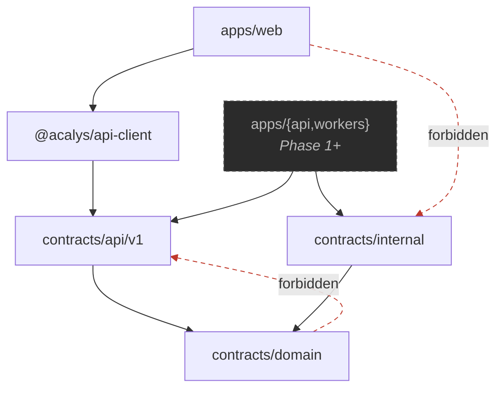

# Phase 0 — completion report

The §130 report: what was built, what it guarantees, what it does not, and exactly what
Phase 1 implements next.

---

## 1. What was implemented

Two packages, ~13,000 lines of source and ~10,000 lines of tests.

### `@acalys/contracts`

```
src/
├── domain/                canonical — provider-, persistence-, agent-neutral
│   ├── primitives/        Brand · JsonValue · canonicalJson · Timestamp · Checksum
│   │                      RepositoryPath · limits · namespaced ids · assertNever
│   ├── identity/          21 branded ids · UUIDv7 factories
│   ├── provider/          SourceProvider · references · capabilities · adapter interface
│   ├── tenancy/           Organization · User · Membership
│   ├── repository/        Repository · ProviderConnection
│   ├── git/               GitObjectId · GitRef · GitComparison
│   ├── actor/             human | system | integration | agent
│   ├── review-target/     pull_request | commit | commit_range | working_tree
│   ├── pull-request/      PullRequest · immutable Revision
│   ├── change/            ChangeManifest · ChangedFile · statistics · risk signals
│   ├── location/          SourceLocation · SymbolReference · LineRange
│   ├── review/            ReviewRequest · ReviewRun · state machine · execution policy
│   ├── evidence/          Evidence · provenance union · strength ladder
│   ├── finding/           CandidateFinding · ReviewFinding · taxonomy · verification
│   │                      lifecycle machine · fingerprint
│   ├── output/            ReviewSummary · ReviewComment · Conversation · SuggestedFix
│   ├── configuration/     glob dialect · PathInstruction · ReviewConfig · resolution
│   │                      ReviewConfigSnapshot
│   ├── knowledge/         KnowledgeReference
│   ├── premerge/          PreMergeCheckResult
│   ├── artifacts/         ArtifactReference · classification · redaction · disclosure
│   ├── tools/  ci/        ToolReference · CiCheckReference
│   ├── errors/            AcalysError hierarchy · SerializedError · retryability
│   └── ports/             Clock · IdGenerator · ContentHasher — interfaces only
├── api/v1/                DTOs · toDto() projections · route manifest · SSE payload
├── internal/              DomainEvent envelope · 17 events · Command envelope · 7 commands
└── generated/schemas/     48 JSON Schema artifacts + manifest
```

### `@acalys/api-client`

Transport-agnostic typed SDK generated from the route manifest. Three error classes, both
directions validated, all 14 routes exercised against an in-memory transport.

### `apps/web`

Relocated from `frontend/` verbatim — git recorded ~100 renames, not a delete-plus-add, so
its history survives. Zero edits inside the app; its self-relative tsconfig and
`__dirname`-based vite config needed none.

---

## 2. Final architecture



`domain` is the base of the graph and imports from neither layer above it. The package
publishes three subpath exports so the boundary is an import path, not a convention.

**The two invariants:**

```
Frontend UI      ──must NOT depend on──>  review-worker internals
Review workers   ──must NOT depend on──>  frontend component structure
```

Both are dependency-cruiser rules, and both have been proven by planting a violation.

---

## 3. Canonical domain model

Full diagram in [domain-model.md](./domain-model.md). The distinctions that matter:

| Kept apart                            | Because merged they lose                                                                              |
| ------------------------------------- | ----------------------------------------------------------------------------------------------------- |
| `ReviewRequest` / `ReviewRun`         | a retry either destroys the failed attempt or looks like a second user request                        |
| `CandidateFinding` / `ReviewFinding`  | "a published finding is not a rejected candidate" becomes a runtime check instead of being structural |
| summary / findings                    | a clean change gets no summary, and Walkthrough and Risk render empty                                 |
| finding / pre-merge check             | severity starts meaning "blocking", and merge policy gets tuned by re-grading defects                 |
| risk area / finding                   | either the risk is hidden or a defect is fabricated                                                   |
| `dismissed` / `stale`                 | whether a human judged it, or the code simply moved on                                                |
| `cancelled` / `superseded` / `failed` | a superseded run reads as an error; a cancelled one triggers a retry                                  |

Identity is branded UUIDv7 throughout, owned in one module (§99). A repository name, a PR
number, a path, and a line number are all explicitly **not** identity.

Finding identity survives movement (§28): line numbers are excluded from the fingerprint,
so adding an import at the top of a file does not report every finding in it as fixed and
re-raise them as new.

---

## 4. State machines

[state-machines.md](./state-machines.md) has both diagrams.

**ReviewRun** — 11 states, 26 transitions, 121-cell matrix tested exhaustively. `publishing`
is the commit point: the only working state with no `cancelled` and no `superseded` edge,
because cancelling mid-publish leaves a partially commented PR nothing can reconcile.

**Finding lifecycle** — 6 states, 8 transitions, 28 rejected. Six rather than §27's eight,
because `candidate` is a _type_ and `rejected` is a `VerificationDecision`.

Both tables are deep-frozen: `Object.freeze` is shallow, and
`allowedTransitionsFrom("queued").push("completed")` would otherwise widen the machine at
runtime.

Property tests additionally prove both machines are fully reachable from their initial
state, have no self-transitions, and that `canTransition` and the assert never diverge.

---

## 5. Runtime validation

Zod v4 is the single source of truth (§54). Types are `z.infer`red, never hand-written
beside a schema; JSON Schema is generated from it.

| Boundary                   | Mode               | Why                                                               |
| -------------------------- | ------------------ | ----------------------------------------------------------------- |
| domain, events, commands   | `strictObject`     | an unknown key is corruption, not compatibility                   |
| inbound API request bodies | `z.object` (strip) | a client on a newer build must not be rejected by an older server |
| API responses              | `strictObject`     | the platform produces them; an extra key is a bug                 |

`null` is never used for absence — `undefined` means absent (§57), and nothing in Phase 0
needed "explicitly cleared".

`tests/schema-conformance.test.ts` asserts at compile time that every schema's output is
assignable to its declared interface. This exists because of a real defect: every optional
field was declared `x?: T` while Zod infers `x?: T | undefined`, and under
`exactOptionalPropertyTypes` those differ — so `reviewRunSchema.parse()` did **not**
produce a `ReviewRun`. A validator that did not validate its own contract, compiling
everywhere except one call site by luck. 43 contracts are now covered.

Determinism (§58): `canonicalJson` sorts keys recursively, and raw `JSON.stringify` is
lint-banned outside two sanctioned sites.

---

## 6. Provider isolation

Detail in [provider-boundaries.md](./provider-boundaries.md). Three independent proofs:

1. **A planted `@octokit/rest` import in `domain/` fails lint** — ESLint bans `@octokit/*`,
   `@gitbeaker/*`, `@prisma/*`, `@anthropic-ai/*`, `bullmq`, `express` from contracts.
2. **A GitHub PR and a GitLab MR describing one change normalize to equal domain
   structures** once provider identity is removed. They differ only in `provider` and
   `externalId` (`"2145998877"` vs `"gid://gitlab/MergeRequest/774411"`).
3. **`node_id`, `merge_request_iid`, `html_url`, and `squash` are each rejected by name.**

`ReviewDecision` is `approve | request_changes | comment | neutral` — deliberately not
GitHub's vocabulary, since GitLab has no `REQUEST_CHANGES` equivalent and a local review has
nowhere to record a verdict.

The local working-tree target is the strongest evidence: no provider, no change request,
nowhere to post a comment, and still a first-class review target (§112).

---

## 7. Persistence readiness

[persistence-plan.md](./persistence-plan.md) maps the contracts onto 19 tables. No Prisma
schema, no migration, no ORM decorator near a domain type (§60).

Decisions already settled:

- `organization_id` **denormalized on every tenant-scoped table** (§9) — a missing tenant
  predicate is the most common cross-tenant bug, and RLS needs the column on the row.
- The JSONB boundary drawn explicitly. Real columns for `severity`, `category`, `state`,
  `verification_decision`, `repository_id`, `revision_id`, `fingerprint_value` — the fields
  §119's policy engine filters on. JSONB only for genuinely variant shapes.
- `unique (idempotency_scope, idempotency_key)` — §47 in one constraint.
- `unique (request_id, attempt)` — a retry is a new row, so the failed attempt survives.
- `unique (pull_request_id, sequence)` — two workers racing to insert revision 3 means one
  fails loudly instead of both succeeding.
- Partial indexes on non-terminal run state and unpublished outbox rows, so both stay small.
- `timestamptz` throughout; never `timestamp without time zone`.

Four decisions are explicitly deferred and listed as such: RLS vs application filtering,
partitioning, the migration tool, and whether candidate findings are retained.

---

## 8. Event architecture

[events.md](./events.md). 17 event types, 7 commands, **separate envelopes**.

A shared base would converge them under maintenance — someone adds a field "to the
envelope" and it lands on both — which is exactly the single generic message model §77
forbids. A command carries `issuedBy`, a required `idempotencyKey`, and `issuedAt`; an
event carries `occurredAt` and nothing else, because a command records an ask and an event
records a fact.

Correlation policy is **stated**, not left optional-everywhere (§49):

```
correlationId   always
causationId     except at a declared ingress (provider_webhook | api_request | …)
traceId         optional — a worker without OpenTelemetry must still emit correct events
```

Naming the ingress is what makes a _missing_ `causationId` elsewhere detectable as a bug
rather than an unexplained absence.

Payloads carry references, not entities: an embedded finding would freeze a copy that is
wrong the moment it resolves, and would sit in every subscriber's queue forever.
`finding.published` carries `severity` and `category` so a notification rule can filter
without a database round trip — the one deliberate exception.

Outbox-ready (§67): stable event ids, a full envelope, and `correlationId`/`causationId` as
columns, so the event row is written inside the same transaction as the state change.

---

## 9. Tests

**1,139 tests across 32 files.** No skipped tests, no commented-out tests, no test-only
branches in `src/`.

| Area                                                 | Tests |
| ---------------------------------------------------- | ----- |
| Run state machine (121-cell matrix)                  | 153   |
| Generated schema artifacts                           | 101   |
| Finding lifecycle (36-cell matrix)                   | 75    |
| Evidence                                             | 71    |
| Glob dialect                                         | 50    |
| Repository path (traversal, encoding, control chars) | 49    |
| Git refs                                             | 40    |
| Fixtures + provider normalization                    | 40    |
| Value objects                                        | 40    |
| Configuration resolution + snapshots                 | 31    |
| Review output (summary, comments, fixes)             | 31    |
| Review request/run                                   | 32    |
| Location                                             | 30    |
| Internal events and commands                         | 29    |
| Timestamps                                           | 27    |
| Change manifest                                      | 27    |
| Finding taxonomy + verification                      | 27    |
| api-client (all 14 routes)                           | 27    |
| Candidate vs review finding                          | 26    |
| Pull request                                         | 25    |
| Fingerprints                                         | 24    |
| Errors                                               | 23    |
| DTO leakage + route manifest                         | 22    |
| Identity                                             | 22    |
| Review target                                        | 22    |
| Canonical JSON                                       | 20    |
| Knowledge + pre-merge                                | 19    |
| Property-based invariants                            | 18    |
| Path instruction precedence                          | 15    |
| API projections                                      | 13    |
| Brand                                                | 6     |
| Schema/interface conformance (43 contracts)          | 4     |

Property-based tests (fast-check) cover: id round-trips, path rejection, timestamp
ordering, canonical-JSON key-order invariance, transition-table self-consistency, machine
reachability, comparator totality, confidence-band monotonicity, fingerprint stability under
line movement, and glob containment.

### Planted violations, each verified to fail then pass

| Invariant                    | Planted                                   | Result                 |
| ---------------------------- | ----------------------------------------- | ---------------------- |
| No provider SDK in contracts | `@octokit/rest` in `domain/configuration` | ESLint error           |
| Domain never imports API     | `domain/` → `api/`                        | depcruise error        |
| UI never sees internals      | `apps/web` → `contracts/internal`         | depcruise error        |
| SDK never sees internals     | `api-client` → `contracts/internal`       | depcruise error        |
| No DTO leakage               | `attempt` on `ReviewRunDto`               | leakage walk failed    |
| Schema drift                 | renamed a property in a generated file    | `schemas:check` exit 1 |

---

## 10. Build status

```
npm run typecheck    ✓  apps/web · @acalys/api-client · @acalys/contracts
npm run lint         ✓  0 problems
npm run format:check ✓  all files
npm run depcruise    ✓  0 violations — 189 modules, 773 dependencies
npm run schemas:check ✓ 49 files match the source
npm run test         ✓  1,139 passed (32 files)
npm run build        ✓  contracts · api-client · web
```

Seven commits, one per checkpoint, each bisectable.

---

## 11. Limitations — what Phase 0 does **not** do

Stated plainly rather than implied:

- **No reviewer.** No prompt, no model call, no agent of any kind (§89).
- **No provider integration.** No GitHub App, no webhook handler, no adapter
  implementation — only the interface.
- **No repository access.** No clone, no worktree, no diff computation. `ChangeManifest`
  describes a change nothing yet produces.
- **No persistence.** A plan, not a schema.
- **No HTTP server or queue.** A route manifest and a client that speaks to a mock
  transport.
- **`apps/web` still renders its fixtures.** It does not call `@acalys/api-client` — there
  is no server to call. Wiring it up is Phase 1, and it is a small change precisely because
  the DTOs were designed against these pages.
- **Two domain services are declared, not implemented.** The cross-aggregate invariants
  needing storage (revision sequence contiguity, config-snapshot ownership) are Phase 1.
- **The generated JSON Schemas are descriptive, not authoritative.** A handful of
  cross-field refinements have no JSON Schema equivalent and are rendered permissively;
  Zod remains the validator, and each artifact says so in its header.

---

## 12. What Phase 1 implements

The definition of done (§133) is that this sequence works **without changing these
contracts**:

```
GitHub App → webhook → ReviewTarget → PullRequest → Revision
           → ReviewRequest → ReviewRun
```

Precise interfaces to implement:

```ts
// packages/providers/github
SourceProviderAdapter {
  normalizeChangeRequest(payload: unknown): ReviewTarget
  normalizeRevision(payload: unknown): PullRequestRevision
  fetchComparison(base: GitObjectId, head: GitObjectId): Promise<GitComparison>
  publishComment(comment: ReviewComment): Promise<ProviderCommentReference>
  publishDecision(decision: ReviewDecision): Promise<void>
}

// packages/database — against the tables in persistence-plan.md
RepositoryStore · PullRequestStore · RevisionStore
ReviewRequestStore · ReviewRunStore · ConfigSnapshotStore
DomainEventOutbox

// packages/telemetry, packages/config
Clock · IdGenerator · ContentHasher      // the three ports, backed by node:crypto

// apps/api — implements every entry in API_ROUTES
// apps/webhook-gateway — provider ingress, emitting root events with origin: provider_webhook
```

Every signature above speaks only canonical types. That is the property this phase existed
to establish.
