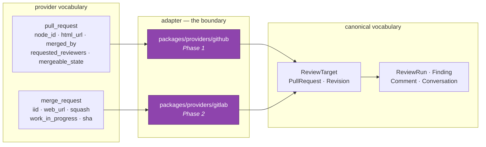

# Provider boundaries

> Provider-specific structure must not leak into canonical review contracts. (§1)

The rule is easy to state and easy to violate by accident, because GitHub's model is
convenient and the platform will support GitHub first. This document records where the
boundary sits, what crosses it, and how the build proves it holds.

---

## Where normalization happens



Everything left of the adapters is a provider's language. Everything right of them is the
platform's. An adapter is the **only** place that knows a provider's field names, and the
only place a provider SDK may be imported.

---

## What the domain keeps, and what it drops

The domain keeps exactly what it needs to identify a change and publish back to it:

```ts
interface ProviderReference {
  provider: SourceProvider; // github | gitlab | bitbucket | local
  externalId: string; // the provider's own id, as a string
}
```

`externalId` is a string even where a provider uses an integer, because GitLab's GraphQL
ids are strings (`gid://gitlab/MergeRequest/774411`) and a numeric column would force one
provider into the other's shape.

**Stability over readability.** An immutable numeric id (`"1296269"`) is preferred over a
mutable path (`"octocat/Hello-World"`): repositories get renamed and transferred, and a
path-keyed row silently detaches from its subject.

`number` is stored for display and is never a key — it is unique per repository at best,
and GitLab shares a numbering space between issues and merge requests.

Dropped entirely: `node_id`, `html_url`, `mergeable_state`, `squash`,
`work_in_progress`, `requested_reviewers`, and every other field whose meaning is defined
by one provider's API. `strictObject` rejects them, and a fixture test names the specific
ones that were considered.

---

## Capability differences (§110)

Providers are not interchangeable, and pretending otherwise is the other half of the
mistake. `ProviderCapabilities` says what each supports:

```ts
interface ProviderCapabilities {
  inlineComments: boolean;
  reviewDecision: boolean;
  suggestionBlocks: boolean;
  threadedComments: boolean;
  checks: boolean;
}
```

The platform's `ReviewDecision` is `approve | request_changes | comment | neutral` —
deliberately **not** GitHub's `APPROVE | REQUEST_CHANGES | COMMENT`, even though the values
look similar. GitLab has no direct equivalent of `REQUEST_CHANGES`, and a `local` review
has nowhere to record a verdict at all. Adapters map outward; nothing in the platform
encodes a provider's API vocabulary.

`neutral` exists because "I deliberately express no opinion" and "I have remarks" are
different outcomes. A review suppressed by policy is `neutral`; collapsing it into
`comment` would make "no verdict" indistinguishable from "no review".

---

## The local case is the strongest test (§112)

A working-tree target has:

- no provider
- no change request
- no comment thread
- nowhere to submit a review decision

and it is still a first-class review target. A domain that had absorbed GitHub's model
could not express it — which is exactly why it is in the fixture set and asserted in
tests. If `provider` were required, or `changeRequest` non-optional, the local path would
be impossible, and the leak would be invisible until someone tried to build the CLI.

---

## How the boundary is proven

**1. A planted SDK import fails the build.**

```
import { Octokit } from "@octokit/rest";   // in contracts/src/domain
→ error  no-restricted-imports: Provider SDKs must terminate at the provider
         adapter boundary (P0.txt §59)
```

ESLint bans `@octokit/*`, `@gitbeaker/*`, `@prisma/*`, `@anthropic-ai/*`, `bullmq`, and
`express` from the contracts package. Verified by planting each and watching lint reject
it.

**2. Two providers normalize to the same object.**

`tests/fixtures.test.ts` holds a GitHub PR and a GitLab MR describing **one change, on one
repository, at one pair of commits**, and asserts:

```ts
stripProviderIdentity(gitlab) === stripProviderIdentity(github);
```

They differ only in `provider` and `externalId`. If a provider concept had leaked into the
canonical type, the two could not agree, and this assertion would be impossible to write.

The complement is also asserted: normalization must not _erase_ which provider a target
came from, or publication could not route.

**3. Provider fields are rejected, by name.**

The same test feeds the canonical schema `node_id`, `merge_request_iid`, `html_url`, and
`squash`, and asserts each is rejected. `strictObject` does the work; the test records
which names were considered, so a future reader knows the omission was a decision.

---

## What Phase 1 implements

`SourceProviderAdapter` is declared here as an interface and implemented then:

```
normalizeChangeRequest   provider payload → ReviewTarget
normalizeRevision        provider payload → PullRequestRevision
fetchComparison          base..head → GitComparison
publishComment           ReviewComment  → provider comment
publishDecision          ReviewDecision → provider review (capability permitting)
```

The signatures speak only canonical types. That is what makes GitLab support a new adapter
rather than a change to the domain — and it is the property this whole document exists to
protect.
