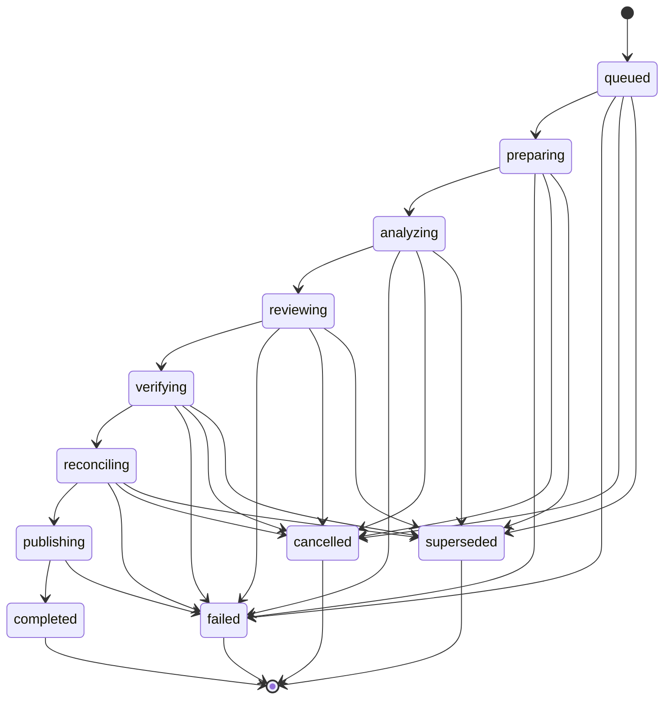
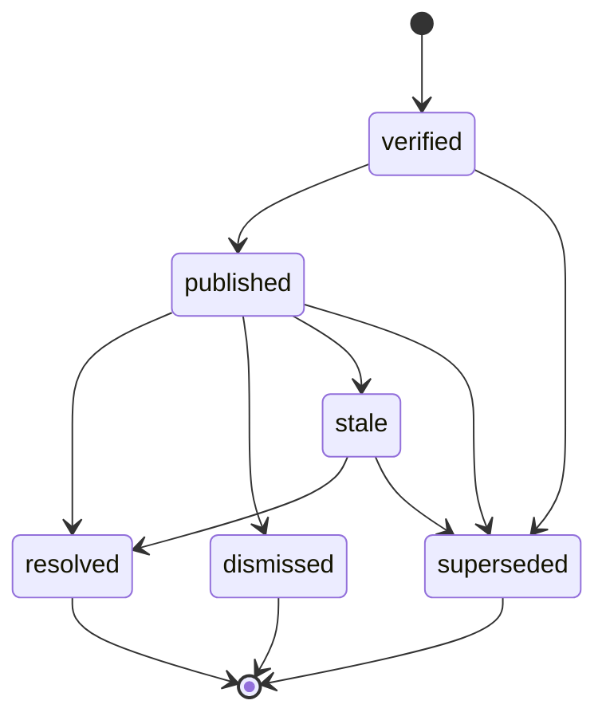

# State machines

Two explicit machines, each a frozen transition table with a full N×N test. Both are
deep-frozen at runtime, because `Object.freeze` is shallow and
`allowedTransitionsFrom("queued").push("completed")` would otherwise widen the machine
from a caller.

---

## ReviewRun: 11 states, 26 transitions



### `publishing` is the commit point

It is the only working state with no `cancelled` and no `superseded` edge, and that
asymmetry is the most important thing in the diagram.

By the time a run reaches `publishing`, comments are going onto the pull request. Cancelling
mid-publish leaves a partially commented PR that no later run can reconcile against — some
findings posted, some not, and no record of which. So `publishing` can only reach
`completed` or `failed`. A cancellation that arrives during publishing is honoured _after_
it finishes, by superseding the run that follows.

### Four terminal states, not one

```
completed    the review finished and published
failed       something went wrong; retryability says whether to try again
cancelled    a human asked it to stop
superseded   the author pushed again; this run is answering an old question
```

Collapsing these into "done" loses the only information anyone needs. A superseded run is
the system working correctly and must not read as an error. A cancelled run must not
trigger a retry. A failed run must — if and only if its `retryability` says so.

### Notably absent

- **`completed → superseded`.** A finished review is a historical fact. Its findings are
  superseded individually, in the finding lifecycle, where supersession belongs.
- **`cancel_requested`.** Two-phase cancellation is orchestration, not domain (§75). A
  workflow engine owns "asked to stop but not yet stopped"; the domain records the
  outcome.
- **Any self-transition.** Re-entering a state is a no-op dressed as progress, and would let
  a stuck worker emit `analyzing → analyzing` forever while looking healthy.

The 121-cell matrix is tested exhaustively: every legal transition passes, every illegal one
throws. A property test additionally proves the machine is fully reachable from `queued`,
so no state is dead vocabulary.

---

## Finding lifecycle: 6 states, 8 transitions



Eight allowed transitions; the other 28 cells throw.

### Six states, not §27's eight

§27 lists eight but also warns against contradictory modelling, and two of the eight are
not lifecycle states at all:

- **`candidate`** is a _type_, not a state. It is `CandidateFinding`, which has different
  fields. Modelling it as a state would mean one type holding both `claim` and `severity`,
  with half of them null at any moment.
- **`rejected`** is a `VerificationDecision`. A rejected candidate never becomes a finding,
  so there is no finding to be in that state — which is what makes §107's "a published
  finding must not be rejected" structural rather than a runtime check.

The lifecycle therefore begins at `verified`: the point at which a finding exists at all.

### `dismissed` versus `stale`

Both stop a finding being shown, and merging them would lose _why_:

```
dismissed   a human judged it not worth acting on   → do not re-raise it
stale       the code it described is gone           → re-raise if it comes back
```

A dismissal is a judgement the platform must respect on future runs. Staleness is the world
moving on, and carries no such instruction. The same distinction separates `resolved` from
`archived` in the conversation states.

---

## The two vocabularies do not overlap

Runs use gerunds — `verifying`, `publishing`, `reconciling`. Findings use participles —
`verified`, `published`. The only shared word is `superseded`, and it means the same thing
in both: replaced by newer work.

This is asserted by a test. A shared state name across two machines is how a consumer ends
up switching on the wrong one.
