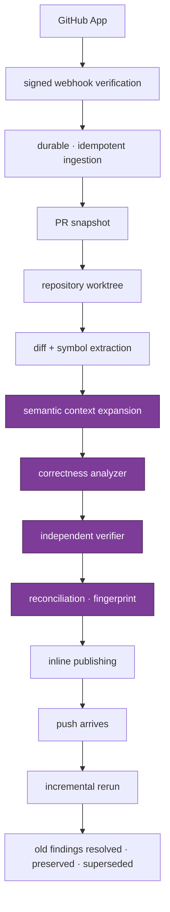

# Phase 1 — one production review path, end to end

Phase 0 built the language. Phase 1 makes something speak it.

The shape of this phase was set by an external architecture audit (August 2026), and the
audit's central warning is the thing to hold onto:

> Do not make Phase 1 `GitHub App → webhook → DB → call LLM → comment`. That produces a
> demo, not a CodeRabbit competitor.

The hardest problem in a review system is not modelling a `Finding`. It is **producing
high-precision findings with low enough noise that engineers do not disable the bot.**
Everything below is arranged around that.

---

## The goal

**One vertical slice, production quality, for correctness findings on GitHub.**

Not breadth. Not fifteen analyzers. One chain, working under real failure conditions:



The purple band is where the product lives. The rest is plumbing that must be correct but
is not differentiating.

If that chain is production-quality for **correctness alone**, the platform is worth
something. Analyzer breadth comes after.

---

## What is design work, and what is wiring

Phase 0 left five capabilities contract-complete. They need runtime, not design:

| Capability            | Contract                                           | Phase 1 work                                        |
| --------------------- | -------------------------------------------------- | --------------------------------------------------- |
| Path instructions     | `PathInstruction`, glob dialect, precedence        | feed resolved instructions into the analyzer prompt |
| Pre-merge checks      | `PreMergeCheckResult`, blocking policy             | implement the check runners                         |
| Summary / walkthrough | `ReviewSummary.changedAreas`, `riskAreas`          | generate and publish                                |
| Conversations         | `ReviewConversation`, `ConversationMessage`        | ingest replies, thread them                         |
| Suggested fixes       | `SuggestedFix`, `EditOperation`, validation ladder | generate, validate, render as suggestion blocks     |

Genuinely new design in Phase 1: repository access, the context planner, the analyzer, the
verifier, reconciliation, and the orchestration backbone.

---

## Order

Depth before breadth. Each numbered item is shippable and testable on its own.

1. **Provider ingestion** — GitHub App, signed webhook verification, durable idempotent
   ingestion, `ReviewTarget`/`PullRequest`/`Revision` normalization.
2. **Persistence + outbox** — the 19 tables from the Phase 0 plan, with the transactional
   outbox from day one rather than retrofitted.
3. **Orchestration** — queue, workers, retries, supersession, cancellation. The state
   machine already says what is legal; this makes it survivable.
4. **Repository access** — clone/fetch, worktree lifecycle, `ChangeManifest` generation.
5. **Code intelligence** — AST, symbol graph, dependency edges. The input the context
   planner needs.
6. **Context planner** — the piece that decides _what the analyzer sees_. Changed symbols,
   callers and callees, dependent modules, tests, configuration, git history, prior
   findings.
7. **Correctness analyzer** — one category, done well.
8. **Verifier** — independent decision, closed reason-code vocabulary, false-positive
   suppression.
9. **Reconciliation** — fingerprint matching across revisions; resolve, preserve, supersede.
10. **Publishing** — inline comments, summary, walkthrough, reconciled against prior runs.
11. **Incremental review** — the full loop closing: push → rerun → correct lifecycle
    outcomes for every prior finding.

Only then: analyzer breadth, tool execution, GitLab, knowledge/learnings, conversations,
autofix, security, CLI/IDE, analytics.

---

## Review-quality gates

**This is the biggest gate missing today, and it is not an engineering gate.**

1,139 passing tests say the contracts hold. They say nothing about whether the reviewer is
any good. A prompt change, a model swap, or a context-planner tweak can pass every one of
them while making the actual reviews substantially worse — and that failure is invisible
until users complain.

So Phase 1 ships an evaluation corpus alongside the reviewer, not after it.

**The corpus.** Several hundred real pull requests, frozen: known defects, and clean
changes that must produce nothing. Clean changes matter as much as buggy ones — a reviewer
that finds problems everywhere scores well on recall and gets turned off.

**Measured on every reviewer change:**

```
precision                      false positives / PR
recall                         duplicate finding rate
critical bug recall            verification rejection rate
security bug recall            finding stability across pushes
severity calibration           resolved-finding detection
confidence calibration         comment usefulness
latency                        tokens / review          cost / review
```

**Selected regressions are CI-blocking.** Which ones, and at what thresholds, is a decision
to make once there is a baseline — setting thresholds before any measurement would be
guessing. But the _gate_ is designed in now, so the reviewer is built against it rather
than measured after the fact.

Two of these deserve emphasis because they are easy to omit:

- **Finding stability across pushes.** The fingerprint contract makes stability
  _possible_; only an eval over real consecutive revisions proves it _happens_.
- **Cost per review.** A reviewer that is excellent and uneconomic is not shippable, and
  cost regressions are silent without a gate.

---

## Resilience

The contracts make these scenarios **representable**. Phase 1 must prove they are
**survivable** — each is a test, not a hope.

**Delivery and ordering**
duplicate webhook delivery · events out of order · simultaneous pushes · force-push · PR
closed mid-analysis · supersession while an agent is running · installation revoked
mid-run · permission change mid-run · branch deleted mid-run

**Process and infrastructure**
worker crash after a side effect · process restart in every review state · DB transaction
rollback · retry without duplicating PR comments · comment publishing partial failure

**External dependencies**
provider 429 and 5xx · model timeout · tool timeout · malformed tool result · repository
clone failure

**Scale and content**
very large PRs · binary and generated files · monorepos · malicious repository content ·
prompt injection in source, comments, and linked issues · secrets appearing in logs and
evidence

**Isolation**
tenant isolation under every path, including the deduplication table and the outbox

The last two are the ones that become incidents rather than bugs. Prompt injection is
particularly under-appreciated: a reviewer reads attacker-controlled text by definition,
and every linked issue, comment, and source file is untrusted input.

---

## Definition of done

Phase 1 is complete when all of these hold:

1. A real GitHub pull request receives a review, end to end, in production conditions.
2. A push produces an incremental review, and every prior finding is correctly resolved,
   preserved, or superseded.
3. Every resilience scenario above has a passing test.
4. The evaluation corpus exists, is measured on every reviewer change, and selected
   regressions block CI.
5. **No Phase 0 contract required a redesign.**

Item 5 is the retrospective test of whether Phase 0 was right. A contract that needed
reshaping is not a failure to hide — it is the most valuable signal this phase can produce,
and it should be recorded rather than quietly patched.

---

## Explicitly not in Phase 1

GitLab, Azure DevOps, Bitbucket · CLI and IDE surfaces · Slack/Discord agents · security
scanning · multi-repo analysis · knowledge and learned preferences · autofix and finishing
touches · analytics and reporting · SSO, RBAC, audit logs · Change Stack, Triage, Plan.

Every one is real product surface and every one is deferred. Attempting them alongside the
first review path leaves all of them shallow — which is the failure mode the audit
identified, and the reason this phase is one slice deep rather than fifteen wide.
