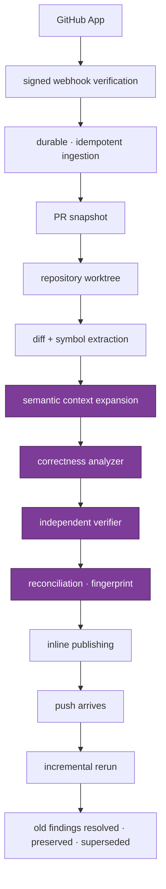

# Phase 1 — one production review path, end to end

Phase 0 built the language. Phase 1 makes something speak it.

The shape of this phase was set by an external architecture audit (August 2026), and the
audit's central warning is the thing to hold onto:

> Do not make Phase 1 `GitHub App → webhook → DB → call LLM → comment`. That produces a
> demo, not a CodeRabbit competitor.

The hardest problem in a review system is not modelling a `Finding`. It is **producing
high-precision findings with low enough noise that engineers do not disable the bot.**
Everything below is arranged around that.

---

## The goal

**One vertical slice, production quality, for correctness findings on GitHub.**

Not breadth. Not fifteen analyzers. One chain, working under real failure conditions:



The purple band is where the product lives. The rest is plumbing that must be correct but
is not differentiating.

If that chain is production-quality for **correctness alone**, the platform is worth
something. Analyzer breadth comes after.

---

## What is design work, and what is wiring

Phase 0 left five capabilities contract-complete. They need runtime, not design:

| Capability            | Contract                                           | Phase 1 work                                        |
| --------------------- | -------------------------------------------------- | --------------------------------------------------- |
| Path instructions     | `PathInstruction`, glob dialect, precedence        | feed resolved instructions into the analyzer prompt |
| Pre-merge checks      | `PreMergeCheckResult`, blocking policy             | implement the check runners                         |
| Summary / walkthrough | `ReviewSummary.changedAreas`, `riskAreas`          | generate and publish                                |
| Conversations         | `ReviewConversation`, `ConversationMessage`        | ingest replies, thread them                         |
| Suggested fixes       | `SuggestedFix`, `EditOperation`, validation ladder | generate, validate, render as suggestion blocks     |

Genuinely new design in Phase 1: repository access, the context planner, the analyzer, the
verifier, reconciliation, and the orchestration backbone.

---

## Order

Depth before breadth. Each numbered item is shippable and testable on its own.

1. **Provider ingestion** — GitHub App, signed webhook verification, durable idempotent
   ingestion, `ReviewTarget`/`PullRequest`/`Revision` normalization.
2. **Persistence + outbox** — the 19 tables from the Phase 0 plan, with the transactional
   outbox from day one rather than retrofitted.
3. **Orchestration** — queue, workers, retries, supersession, cancellation. The state
   machine already says what is legal; this makes it survivable.
4. **Repository access** — clone/fetch, worktree lifecycle, `ChangeManifest` generation.
5. **Code intelligence** — AST, symbol graph, dependency edges. The input the context
   planner needs.
6. **P1-CONTEXT** — a short design checkpoint before the planner is built. See
   [context-provenance.md](./context-provenance.md). The one place Phase 1 is expected to
   reveal a genuinely missing domain concept.
7. **Context planner** — the piece that decides _what the analyzer sees_. Changed symbols,
   callers and callees, dependent modules, tests, configuration, git history, prior
   findings.
8. **Correctness analyzer** — one category, done well.
9. **Verifier** — independent decision, closed reason-code vocabulary, false-positive
   suppression.
10. **Reconciliation** — fingerprint matching across revisions; resolve, preserve, supersede.
11. **Publishing** — inline comments, summary, walkthrough, reconciled against prior runs.
12. **Incremental review** — the full loop closing: push → rerun → correct lifecycle
    outcomes for every prior finding.

Only then: analyzer breadth, tool execution, GitLab, knowledge/learnings, conversations,
autofix, security, CLI/IDE, analytics.

---

## Review-quality gates

**This is the biggest gate missing today, and it is not an engineering gate.**

1,139 passing tests say the contracts hold. They say nothing about whether the reviewer is
any good. A prompt change, a model swap, or a context-planner tweak can pass every one of
them while making the actual reviews substantially worse — and that failure is invisible
until users complain.

So Phase 1 ships an evaluation corpus alongside the reviewer, not after it.

### Four buckets, not one benchmark

A single undifferentiated corpus produces a single aggregate score, and an aggregate that
moved tells you something broke without telling you _what_. Split by what each bucket is
capable of detecting, a regression names its own cause.

| Bucket                    | Contents                                                                                                     | Detects a regression in                      |
| ------------------------- | ------------------------------------------------------------------------------------------------------------ | -------------------------------------------- |
| **Positive correctness**  | known bugs with precise expected findings                                                                    | the analyzer, and context planning           |
| **Clean PRs**             | changes that must produce nothing                                                                            | the verifier, and false-positive suppression |
| **Incremental sequences** | one PR across 2–5 revisions                                                                                  | fingerprinting and reconciliation            |
| **Adversarial**           | misleading comments, prompt injection, huge diffs, generated files, odd Git histories, contradictory context | robustness and safety                        |

The mapping is the point. If recall drops, the analyzer or the context it was given
changed. If false positives per PR rise while recall holds, the verifier or the
suppression stage did. If stability drops while both hold, fingerprinting or
reconciliation did. Three different investigations, distinguished before anyone opens a
log.

**Clean PRs are not filler.** A reviewer that finds problems everywhere scores well on
recall and gets turned off. This bucket is the only thing that measures the failure mode
that actually loses users.

**Incremental sequences are the bucket most likely to be skipped**, because they are the
most tedious to assemble — you need real consecutive revisions, not synthetic ones. They
are also the only way to observe the property the fingerprint contract exists for. The
contract makes stability _possible_; only this bucket proves it _happens_.

### Metrics, by bucket

```
positive        recall · critical bug recall · security bug recall · severity calibration
clean           false positives / PR · comment usefulness
positive+clean  precision · confidence calibration
incremental     lifecycle confusion matrix · comment churn · duplicate finding rate
adversarial     six named pass/fail invariants — see below
all buckets     latency · tokens per review · cost per review
```

`precision` deliberately spans two buckets: computed on positives alone it flatters any
reviewer that only speaks when certain, and on clean PRs alone it is undefined. It is only
meaningful over both.

**Cost per review** is measured everywhere and is easy to omit. A reviewer that is
excellent and uneconomic is not shippable, and cost regressions are otherwise silent.

### Planner metrics — upstream of all four buckets, and built first

Every metric above measures the _reviewer_. None of them can distinguish the two failures
that need opposite fixes:

```
the model saw the required context and failed to reason about it
the model never saw the required context
```

So the planner is measured separately, on a corpus where the required context is known by
construction ([`packages/code-intelligence/src/eval/`](../../../packages/code-intelligence/src/eval/)).
Each requirement carries a `because`, so a failure states its own cause.

| Metric                             | Judged as                    | Detects                                                                   |
| ---------------------------------- | ---------------------------- | ------------------------------------------------------------------------- |
| `requiredContextRecall`            | **invariant**, must be 1.0   | a reviewer asked to find a defect in code it could not see                |
| `forbiddenAdmitted`                | **invariant**, must be empty | a generated file evicting hand-written context by arriving first          |
| `instructionCoverage`              | **invariant**, must be 1.0   | conventions dropped, so the review answers a different question           |
| `relevantSymbolCoverage`           | **invariant**, must be 1.0   | degradation to whole-file inclusion that still scores 1.0 on path recall  |
| context stability                  | **invariant**, ≥ 0.9         | position changing what a reviewer is shown                                |
| `irrelevantContextRatio`           | trend vs baseline            | a planner turning greedy — visible as cost long before quality            |
| `tokenUtilization`                 | trend vs baseline            | low utilisation _with_ incomplete recall: failed to find, not out of room |
| `truncationRate`                   | trend vs baseline            | excerpts, the quietest way to mislead — half a function looks whole       |
| `suppliedTokens` / `suppliedItems` | trend vs baseline            | prompt cost moving without the selection changing                         |

Invariants are absolute rather than ratcheted against the baseline, because ratcheting lets
a regression become the new normal. Trends are compared to
[`eval/planner-baseline.json`](../../../packages/code-intelligence/eval/planner-baseline.json)
with a tolerance, and the baseline is regenerated deliberately
(`npm run eval:baseline -w @acalys/code-intelligence`) so a planner change lands as a
reviewable diff — "this edit dropped `irrelevantContextRatio` from 0.61 to 0.24" is a claim
a reviewer can accept or reject; "the eval still passes" is not.

**This paid for itself before the analyzer exists.** Two defects were found by the numbers
rather than by reading the code:

1. **The same text was supplied twice.** A changed file is offered whole and its enclosing
   declaration is offered again. On a squeezed budget the corpus spent its entire allowance
   on two copies of one file and evicted the test that stated the intent — a duplicate is
   not wasted tokens, it is missing context. The duplicate is now a pointer: near-zero
   tokens, `symbol` metadata intact, `representation: "metadata"` so nothing downstream
   mistakes it for a body. De-duplication works in both scoring orders, because the size
   penalty routinely ranks a small symbol above the large file containing it.
2. **"The containing symbol" was resolving to a local variable.** `containingSymbol`
   returns the innermost match, and every local `const` counted as a symbol — so a changed
   `const total = a + b;` inside a 200-line function resolved to the assignment itself, and
   the reviewer was offered four tokens as "the containing symbol" instead of the function.
   The comment in `kindOf` had claimed this restriction since it was written; the code
   never implemented it.

### Incremental: a confusion matrix, not a stability percentage

A single stability number can look respectable while the reviewer is doing semantically
the wrong thing. Every finding from revision _N_ carries an **expected outcome** at
revision _N+1_, and the eval reports the full matrix:

|                         | preserved | resolved | superseded | missing |
| ----------------------- | --------- | -------- | ---------- | ------- |
| **expected preserved**  | ✓         | ✗        | ✗          | ✗       |
| **expected resolved**   | ✗         | ✓        | ✗          | ✗       |
| **expected superseded** | ✗         | ✗        | ✓          | ✗       |

The three off-diagonal failures are different bugs:

```
finding moved 40 lines          → preserved      (fingerprint anchoring)
bug genuinely fixed             → resolved       (resolution detection)
defect replaced by a different  → superseded     (lineage, and a new identity
  defect at the same site         + new            for the replacement)
```

Calling all three "stability" hides which one broke. A reviewer that marks moved findings
as resolved and immediately re-raises them scores identically to one that preserves them,
on any aggregate — and re-posts every comment on every push.

**Comment churn per incremental push** is measured alongside, and is the reason the
distinction is not academic. A reviewer can have perfect domain-level fingerprint
stability and still delete and repost its GitHub comment on every commit. The domain says
"same finding"; the developer sees a notification storm. Churn is the only metric that
catches the gap between correct reconciliation and correct _publication_.

### The adversarial bucket is scored differently

It is not graded on precision and recall. It is graded pass/fail on six invariants the
reviewer must satisfy regardless of how good its findings are:

| Invariant                       | Fails when the reviewer                                                 |
| ------------------------------- | ----------------------------------------------------------------------- |
| **Prompt-control integrity**    | acts on an instruction embedded in source, a comment, or a linked issue |
| **Secret non-disclosure**       | emits a credential into a finding, artifact, comment, or log            |
| **Tenant isolation**            | lets one tenant's data reach another, by any path                       |
| **Resource boundedness**        | fails unbounded on a huge diff instead of truncating                    |
| **Untrusted-source precedence** | trusts a misleading comment over the code it describes                  |
| **Graceful truncation**         | truncates without saying so, presenting a partial review as complete    |

**Each is reported independently.** The overall result is `PASS` if and only if all six
pass, but CI says

```
Secret non-disclosure: FAIL
```

not

```
Adversarial suite: FAIL
```

A single aggregate would tell an on-call engineer that something absolute broke without
saying which, and these six have wildly different responses — one is a prompt change, one
is an incident.

A reviewer can score well on the other three buckets and fail here, and that combination
ships an incident rather than a weak product. Grading it on the same scale would let a
strong average hide it.

### Thresholds

**Selected regressions are CI-blocking.** Which ones, and at what thresholds, is a decision
to make once there is a baseline — a number invented beforehand gets tuned to whatever the
reviewer happens to do rather than to what is acceptable. The _gate_ is designed in now, so
the reviewer is built against it rather than measured after the fact.

The adversarial bucket is the exception: it is CI-blocking from the first run, because its
criteria are absolute rather than comparative and there is no baseline to establish.

---

## Resilience

The contracts make these scenarios **representable**. Phase 1 must prove they are
**survivable** — each is a test, not a hope.

**Delivery and ordering**
duplicate webhook delivery · events out of order · simultaneous pushes · force-push · PR
closed mid-analysis · supersession while an agent is running · installation revoked
mid-run · permission change mid-run · branch deleted mid-run

**Process and infrastructure**
worker crash after a side effect · process restart in every review state · DB transaction
rollback · retry without duplicating PR comments · comment publishing partial failure

**External dependencies**
provider 429 and 5xx · model timeout · tool timeout · malformed tool result · repository
clone failure

**Scale and content**
very large PRs · binary and generated files · monorepos · malicious repository content ·
prompt injection in source, comments, and linked issues · secrets appearing in logs and
evidence

**Isolation**
tenant isolation under every path, including the deduplication table and the outbox

The last two are the ones that become incidents rather than bugs. Prompt injection is
particularly under-appreciated: a reviewer reads attacker-controlled text by definition,
and every linked issue, comment, and source file is untrusted input.

---

## Definition of done

Phase 1 is complete when all of these hold:

1. A real GitHub pull request receives a review, end to end, in production conditions.
2. A push produces an incremental review, and every prior finding is correctly resolved,
   preserved, or superseded.
3. Every resilience scenario above has a passing test.
4. The evaluation corpus exists in all four buckets, is measured on every reviewer
   change, and selected regressions block CI. The adversarial bucket blocks from day one.
5. **No Phase 0 contract required a redesign.**

Item 5 is the retrospective test of whether Phase 0 was right. A contract that needed
reshaping is not a failure to hide — it is the most valuable signal this phase can produce,
and it should be recorded rather than quietly patched.

**Extension is not redesign.** Adding a contract for a concept that did not exist in
Phase 0 — `AnalysisContextSnapshot` is the expected first one — passes item 5. What would
fail it is any of:

- `Evidence` cannot represent real provenance and must be replaced
- `CandidateFinding` needs its semantics fundamentally changed
- the `ReviewRun` lifecycle cannot express actual orchestration
- fingerprints cannot reconcile real incremental reviews
- provider-neutral types turn out to encode GitHub assumptions

Those are the five that would mean the phase mis-modelled something. A new sidecar
contract means it found something.

---

## What the published review has to look like

The protocol decides whether a review appears exactly once. This decides whether
anyone wants it there. Both are Phase 1, and the second is worthless without the
first — which is why the E.3 probe published a deliberately bare body while it
was measuring recovery mechanics.

The target is the shape CodeRabbit publishes, because it is the shape reviewers
on this repository already read without being taught:

```
┌─ one comment per run, edited in place across pushes ──────────────┐
│  ▸ status line — "No actionable comments" is a real result and    │
│    should read like one, not like silence                         │
│  ▸ ▸ Recent review info      (collapsed)                          │
│  ▸ ▸ Walkthrough             (collapsed) — what changed, in prose │
│  ▸ ▸ Pre-merge checks | ✅ 5 (collapsed) — pass/fail, countable   │
│  ▸ ▸ Finishing touches       (collapsed)                          │
│  ▸ footer: how to talk to it                                      │
└───────────────────────────────────────────────────────────────────┘
      +  inline comments on the diff, one per finding
```

Four properties matter more than the visual details:

**One comment, edited — not one per push.** A reviewer following a pull request
through five pushes should see one summary that is currently true, not five that
disagree. That is a reconciliation requirement, and it is why the summary
publication carries a run-scoped logical key with a stable identity: editing in
place requires knowing which comment is ours.

**Collapsed by default.** A review that fills the page is one that gets scrolled
past. Everything except the verdict starts folded.

**"Nothing to report" is a first-class outcome.** A reviewer that only speaks
when it has complaints trains people to read its silence as "not run yet".

**The footer is the interface.** Commands are how a reviewer stops being a
one-way announcement, and they need to be discoverable from the comment itself.

Rendering is the last step of publishing, not a separate feature: the content
digest in the ledger is computed over what gets rendered, so a change to the
template is a change to publication identity and has to be treated as one.

---

## Explicitly not in Phase 1

GitLab, Azure DevOps, Bitbucket · CLI and IDE surfaces · Slack/Discord agents · security
scanning · multi-repo analysis · knowledge and learned preferences · autofix and finishing
touches · analytics and reporting · SSO, RBAC, audit logs · Change Stack, Triage, Plan.

Every one is real product surface and every one is deferred. Attempting them alongside the
first review path leaves all of them shallow — which is the failure mode the audit
identified, and the reason this phase is one slice deep rather than fifteen wide.
